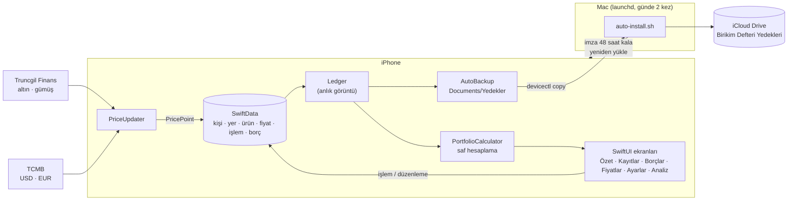

<p align="center">
  
</p>

<p align="center">
  
  
  
  
  
  
  <a href="LICENSE"></a>
</p>

**Birikim Defteri**, altın, gümüş, döviz, fon ve TL birikimlerini; kimde, nerede ve ne maliyetle durduklarını takip eden kişisel bir iPhone uygulaması. Bütün veriler cihazda kalır: sunucu yok, hesap yok, analitik yok. İnternete yalnızca herkese açık güncel fiyatları almak için çıkılır.

> *A personal savings tracker for iPhone (gold, silver, FX, funds, TRY) built with SwiftUI, SwiftData and Swift Charts. Fully on-device, no third-party dependencies, Turkish UI.*

## Öne çıkanlar

- **Net varlık özeti:** varlıklar, borçlar ve kâr/zarar tek kartta. Kişi filtresi (Herkes / tek kişi) ve ürüne, türe, kişiye ya da yere göre halka grafik.
- **Ortalama maliyet yöntemi:** bakiyeler her zaman işlemlerden hesaplanır (kişi × ürün × yer). Satış, ortalama maliyetten düşer. Eldekinden fazla satış ve sonraki bir satışı karşılıksız bırakan düzenleme ya da silme engellenir.
- **Analiz (BI):** değer ve maliyet geçmişi (dokunarak o günü görme), türlerin zaman içindeki payı, aylık alım ve satım, alış maliyetine göre ürün getirisi, gerçekleşen kâr/zarar ve temel göstergeler (borç/varlık oranı, aylık taksit…).
- **Varlıklarım nerede?:** banka, aracı kurum ve fiziki yer başına içerik, toplam ve pay.
- **Güncel fiyatlar:** altın çeşitleri ve gümüş için Kapalıçarşı alış fiyatı, dolar ve euro için TCMB kuru. Fiyatlar elle de girilebilir.
- **Borçlar:** kredi, kredi kartı ve diğer; kuruma göre gruplama, türe göre ara toplamlar, aylık taksit toplamı.
- **Güvenlik:** zorunlu Face ID kilidi (cihaz şifresi yedekli); uygulama değiştiricide içerik gizlenir.
- **Yedek:** JSON dışa ve içe aktarma. Otomatik yedekler Mac üzerinden iCloud Drive'a çekilir.
- **Yerel his:** açık ve koyu mod, Dynamic Type; çizilmiş ürün simgeleri (külçe, sikke, bilezik, döviz rozetleri).

## Ekran görüntüleri

<sub>Görüntüler simülatörde, uygulamanın uydurma örnek verisiyle (`-demoData`) alınmıştır.</sub>

<table>
  <tr>
    <td align="center"><br><sub>Özet</sub></td>
    <td align="center"><br><sub>Dağılım</sub></td>
    <td align="center"><br><sub>Ürünler ve son 6 ay</sub></td>
  </tr>
  <tr>
    <td align="center"><br><sub>Analiz: değer ve maliyet</sub></td>
    <td align="center"><br><sub>Temel göstergeler</sub></td>
    <td align="center"><br><sub>Alış maliyetine göre getiri</sub></td>
  </tr>
  <tr>
    <td align="center"><br><sub>Varlıklarım nerede?</sub></td>
    <td align="center"><br><sub>Kayıtlar</sub></td>
    <td align="center"><br><sub>Borçlar</sub></td>
  </tr>
  <tr>
    <td align="center"><br><sub>Fiyatlar</sub></td>
    <td align="center"><br><sub>Koyu mod</sub></td>
    <td></td>
  </tr>
</table>

## Teknoloji

| Katman | Kullanılan |
|---|---|
| Arayüz | SwiftUI (TabView, NavigationStack, List/Form), Dynamic Type, açık/koyu mod |
| Veri | SwiftData; para ve miktarlar kayıpsız kalsın diye `Decimal`, metin olarak saklanır |
| Grafikler | Swift Charts: `SectorMark`, `AreaMark`, `LineMark`, `BarMark`, `RuleMark`, `chartXSelection` |
| Hesaplama | Saf Swift `PortfolioCalculator`; SwiftUI'dan bağımsız, birim testli |
| Güvenlik | LocalAuthentication (`deviceOwnerAuthentication`) |
| Ağ | `URLSession`; yalnızca herkese açık fiyat kaynakları |
| Test | Swift Testing: 33 test, 10 grup |
| Araçlar | Elle yazılmış Xcode projesi (dosya sistemiyle eşitlenen gruplar), `xcodebuild`, `devicectl`, launchd |
| Bağımlılık | Yok. Üçüncü taraf paket kullanılmıyor. |

## Mimari



Bakiyeler hiçbir yerde saklanmaz; her zaman işlemlerden hesaplanır. Görünümler SwiftData sorgularından kurulan `Ledger` değerini ortamdan (environment) okur. Bütün hesaplar SwiftUI'ı hiç bilmeyen `PortfolioCalculator` içindedir:

- ortalama maliyetli bakiyeler
- satış doğrulama
- gruplama
- eksik fiyat
- kişi filtresi
- değer geçmişi
- gerçekleşen kâr/zarar
- aylık akış ve yer dökümü

## Proje yapısı

```
BirikimDefteri/
├── App/            Uygulama girişi, kök görünüm, Face ID kilidi
├── Core/           Saf katman: tipler, PortfolioCalculator, biçimlendirme (tr_TR), fiyat ayrıştırma
├── Models/         SwiftData modelleri, Ledger, yedek (JSON), fiyat güncelleyici, otomatik yedek, örnek veri
├── Views/          Özet, Kayıtlar, Borçlar, Fiyatlar, Ayarlar, Analiz; simgeler ve tema
└── Assets.xcassets Uygulama simgesi, logo, renkler
BirikimDefteriTests/ Swift Testing birim testleri
scripts/            install.sh (cihaza yükleme), auto-install.sh (zamanlanmış yenileme ve yedek)
docs/               README görselleri
```

## Gizlilik

- Veriler yalnızca cihazda, SwiftData deposunda durur. Hesap, sunucu, analitik ya da reklam yok.
- İnternete giden istekler yalnızca şu iki adrese gider ve kişisel veri içermez: `finans.truncgil.com/today.json`, `www.tcmb.gov.tr/kurlar/today.xml`.
- Otomatik yedekler uygulamanın kendi klasöründe tutulur ve yalnızca kullanıcının kendi Mac'i tarafından kendi iCloud Drive'ına kopyalanır.
- Depodaki örnek veriler (`DemoData.swift`) ve test verileri uydurmadır.

## Fiyat kaynakları

| Ürün | Kaynak | Fiyat |
|---|---|---|
| Gram, çeyrek, yarım, tam, Cumhuriyet, Reşat, Ata altın; 22/18/14 ayar | [Truncgil Finans](https://finans.truncgil.com/today.json) | Kapalıçarşı alış |
| Gram gümüş | Truncgil Finans | Alış |
| Dolar, euro | [TCMB](https://www.tcmb.gov.tr/kurlar/today.xml) (yedek: Truncgil) | Döviz alış |

Ürünler adlarından tanınır (`Core/Quotes.swift`). Fonların ve TL'nin fiyatı elle kalır. Truncgil yanıtı zaman zaman yarıda kesildiği için birkaç kez denenir; kesik yanıttaki değerler de ayıklanır. Değerlemede alış fiyatının kullanılması bilinçli bir tercih: satsanız elinize geçecek tutarı gösterir.

## Kurulum

**Gereksinimler:** Xcode 16 veya üzeri (Xcode 27 ile geliştirildi), iOS 17 veya üzeri bir iPhone, ücretsiz bir Apple hesabı (Personal Team).

1. Xcode > Settings > Apple Accounts'tan Apple hesabınızı ekleyin, ardından **Manage Certificates… > + > Apple Development** ile sertifika oluşturun.
2. iPhone'u kabloyla bağlayıp **Bu Bilgisayara Güven** deyin. **Ayarlar > Gizlilik ve Güvenlik > Geliştirici Modu**'nu açın.
3. Derleyip yükleyin. Betik, imza takımını sertifikanızdan kendisi okur:

   ```bash
   ./scripts/install.sh
   ```

4. İlk açılışta iPhone'da **Ayarlar > Genel > VPN ve Aygıt Yönetimi**'nden geliştiriciye **Güven** deyin.

Kendi kopyanız için `PRODUCT_BUNDLE_IDENTIFIER` değerini değiştirin. Xcode'dan çalıştıracaksanız Signing & Capabilities'te takımınızı seçin.

### Ücretsiz imzanın 7 günlük süresi

Ücretsiz hesapla imza 7 gün geçerli. Aşağıdaki komut, her gün 09:00 ve 20:30'da çalışan bir launchd görevi kurar:

```bash
./scripts/auto-install.sh --enable
```

Görev her çalıştığında:
- iPhone'daki yeni yedekleri iCloud Drive'a çeker,
- imzanın bitmesine 48 saatten az kaldıysa uygulamayı kablosuz ya da kabloyla yeniden yükler,
- sonucu Mac bildirimiyle haber verir.

Yükleme her seferinde yeni bir 7 günlük profil alır; veriler silinmez. Telefonun Mac ile aynı ağda olması yeterli. Kayıt `~/Library/Logs/BirikimDefteri/auto-install.log` dosyasında; kaldırmak için `--disable`.

## Yedekleme ve geri yükleme

- **Otomatik:** Uygulama, veriler değiştikçe `Documents/Yedekler` klasörüne tarihli bir JSON yazar ve son 30'unu tutar. Mac'teki görev bunları **iCloud Drive > Birikim Defteri Yedekleri** klasörüne çeker ve son 90'ını tutar.
- **Elle:** Ayarlar > Yedeği dışa aktar / Yedekten geri yükle. Geri yükleme mevcut verinin yerine geçer.
- **Silmeden ekleme:** Yedek biçimindeki bir dosya uygulamanın Documents klasörüne `BirikimDefteri-ekle.json` adıyla bırakılırsa uygulama açılışta onu mevcut verilere ekler. Kişi, yer ve ürünleri adla eşleştirir; aynı kimlikli kayıtları günceller:

  ```bash
  xcrun devicectl device copy to --device <UDID> --domain-type appDataContainer \
    --domain-identifier com.kadirtuna.birikimdefteri --source ekle.json --destination Documents/BirikimDefteri-ekle.json
  ```

## Geliştirme

```bash
xcodebuild test -project BirikimDefteri.xcodeproj -scheme BirikimDefteri \
  -destination 'platform=iOS Simulator,name=iPhone 14' -parallel-testing-enabled NO
```

Paralel test, her çalıştırmada simülatörün bir kopyasını oluşturup diski doldurduğu için kapalı.

Örnek veriyle simülatörde açmak için (yalnızca Debug derleme; mevcut veriyi siler, kilidi atlar):

```bash
xcrun simctl launch booted com.kadirtuna.birikimdefteri -demoData
```

## Lisans

[MIT](LICENSE) © 2026 Kadir Tuna
