<p align="center">
  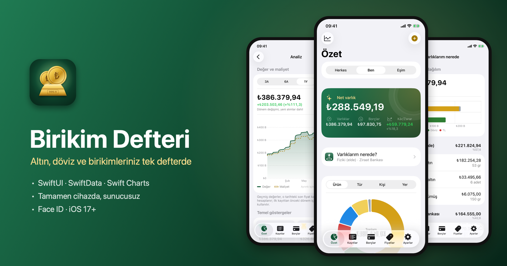
</p>

<p align="center">
  
  
  
  
  
  
  <a href="LICENSE"></a>
</p>

<p align="center">
  <a href="#english"><b>English</b></a> · <a href="#turkce"><b>Türkçe</b></a>
</p>

## Screenshots · Ekran görüntüleri

<sub>Captured in the Simulator with the app's synthetic demo data (<code>-demoData</code>). · Görüntüler simülatörde, uygulamanın uydurma örnek verisiyle (<code>-demoData</code>) alınmıştır.</sub>

<table>
  <tr>
    <td align="center">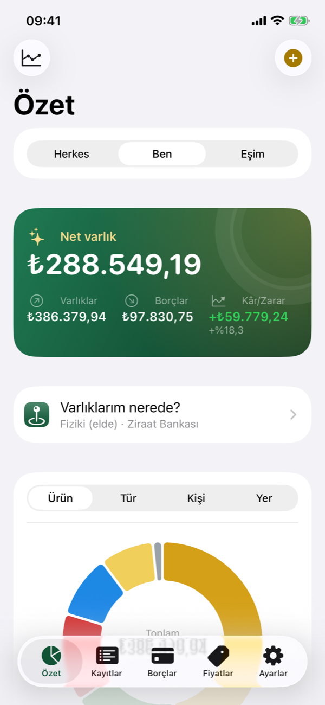<br><sub>Summary · Özet</sub></td>
    <td align="center">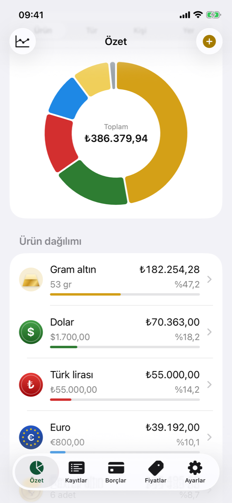<br><sub>Allocation · Dağılım</sub></td>
    <td align="center">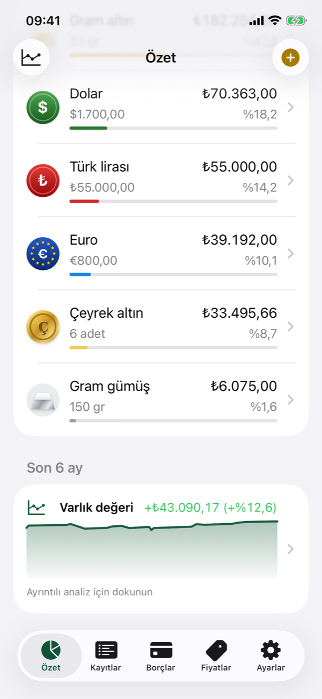<br><sub>Holdings and last 6 months · Ürünler ve son 6 ay</sub></td>
  </tr>
  <tr>
    <td align="center">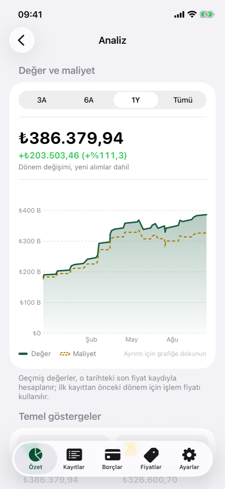<br><sub>Value and cost · Değer ve maliyet</sub></td>
    <td align="center">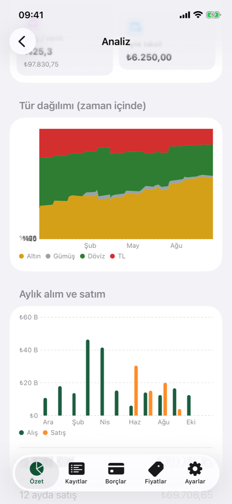<br><sub>Key metrics · Temel göstergeler</sub></td>
    <td align="center">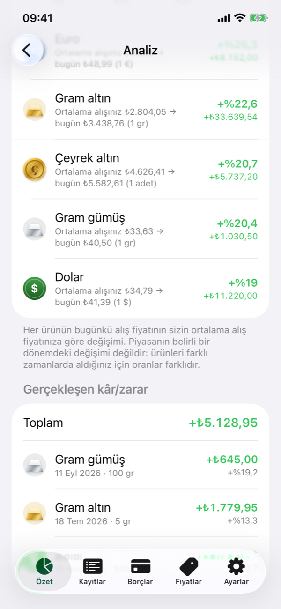<br><sub>Return on your cost · Alış maliyetine göre getiri</sub></td>
  </tr>
  <tr>
    <td align="center">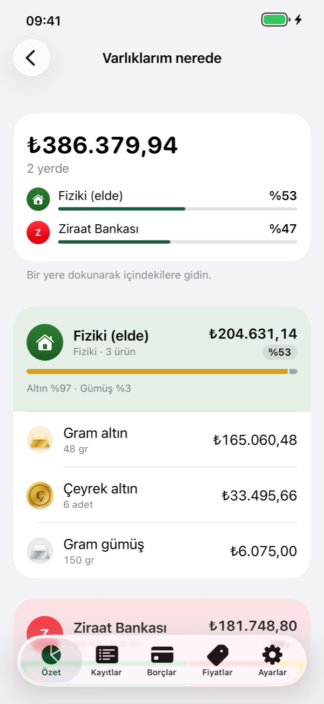<br><sub>Where are my assets? · Varlıklarım nerede?</sub></td>
    <td align="center">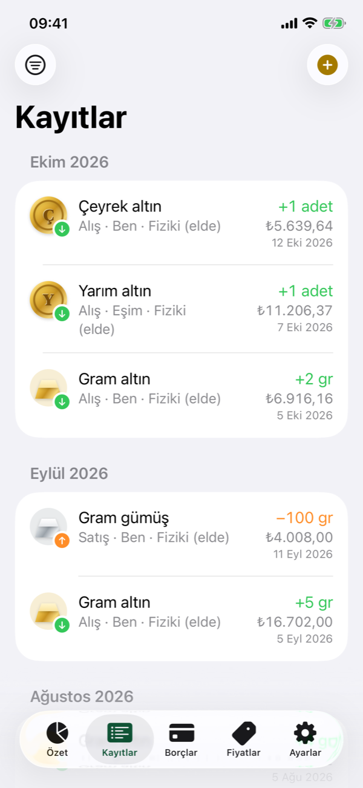<br><sub>Transactions · Kayıtlar</sub></td>
    <td align="center">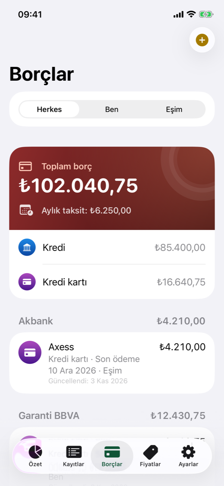<br><sub>Debts · Borçlar</sub></td>
  </tr>
  <tr>
    <td align="center">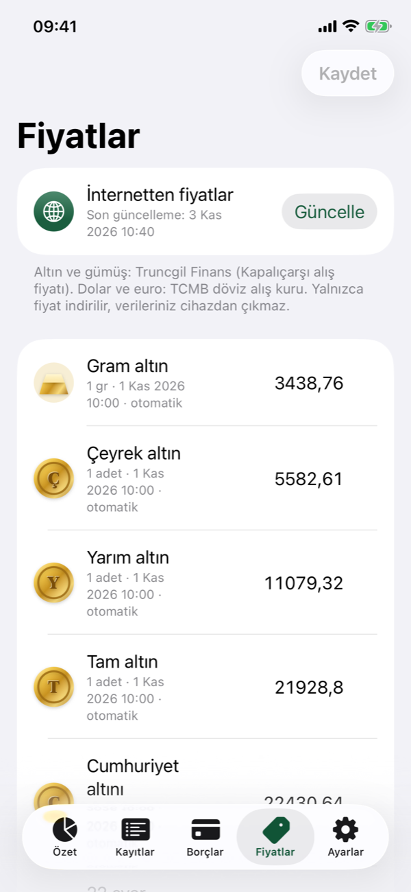<br><sub>Prices · Fiyatlar</sub></td>
    <td align="center">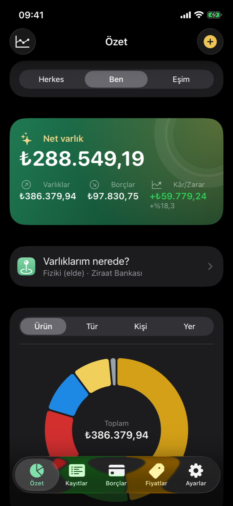<br><sub>Dark mode · Koyu mod</sub></td>
    <td></td>
  </tr>
</table>

---

<a id="english"></a>

## English

**Birikim Defteri** ("savings ledger") is a personal iPhone app for tracking gold, silver, foreign currency, funds and Turkish lira savings: who owns what, where it is held and what it cost. Everything stays on the device. There is no server, no account and no analytics. The app only goes online to fetch public market prices. The interface is in Turkish and uses `tr_TR` number formats (₺1.234,50).

### Highlights

- **Net worth at a glance:** assets, debts and profit/loss on one card, with today's change and when prices were last updated; pull down to refresh prices. Filter by person (everyone or one person) and see a donut chart grouped by product, category, person or location; tap a slice to see its value and share. Payments due within a week are listed on the summary, and the Debts tab shows a badge.
- **Average-cost accounting:** balances are never stored; they are always derived from transactions (person × product × location). A sale removes cost at the average cost. The app rejects selling more than you hold, and edits or deletions that would leave a later sale uncovered.
- **Analytics:**
  - value vs. cost history; tap the chart to see any date
  - the same history in lira, US dollars or grams of gold, to see real growth beyond inflation
  - category share over time
  - monthly buys and sells
  - per-product return on your own cost, shown apart from the product's market price change
  - realized profit/loss
  - key metrics such as debt-to-assets ratio and monthly installments
  - a one-page monthly PDF report to share or save
- **Where are my assets?:** contents, totals and share per bank, brokerage or physical location.
- **Transfers:** move holdings between locations (e.g. from a safe to a bank account) without a fake sale; the cost basis moves with them.
- **Goals:** net worth or product quantity targets (e.g. 100 g of gold) with progress and an estimated date based on the last 3 months.
- **Live prices:** Grand Bazaar (Kapalıçarşı) bid prices for gold coins, bracelets and silver; central bank (TCMB) rates for USD and EUR, each with a 30-day sparkline and change badge. Prices can always be entered by hand.
- **Debts:** loans, credit cards and others; grouped by institution with per-type subtotals and total monthly installments. Each debt keeps a payment history, a progress ring and an estimated payoff date, and local notifications remind you of card due dates and installment days.
- **Fast entry:** amounts are grouped as you type (1.234,50), new records start with the last person and location, and any record can be repeated with today's date from a swipe or a long-press menu (edit, repeat, transfer, delete). Records are searchable and each month shows its total buys and sells.
- **Nothing is lost:** every change to transactions, transfers, debts and payments is logged and can be undone. Deletions (including goals, people, locations and products with their price history) and backup restores are kept forever under Deleted and can be brought back at any time; a restore can itself be undone.
- **Siri and Shortcuts:** "Birikim Defteri ile alım ekle" adds a buy or sell without opening the app, using the last person and location and the current price. Works from the Shortcuts app and the Action button.
- **Security:** mandatory Face ID lock with device passcode fallback. Content is hidden in the app switcher, and an eye button hides all amounts when someone is looking.
- **Backups and export:** JSON export and import. Automatic backups are pulled to iCloud Drive by the owner's Mac. Transactions, holdings and debts export as CSV files that open directly in Excel.
- **Bank logos:** 54 Turkish banks and brokerages are recognized from location and debt names and shown with their logo. Logos are trademarks, so they are not in this repository: `scripts/fetch-logos.py` downloads them for your own build, from each institution's website or, when the site only has a tiny favicon, from its official App Store app. Without them, each institution shows a monogram in its brand color.
- **In-app guide:** Settings > Kullanım kılavuzu explains every feature, where to find it and how it works, with search.
- **Native feel:** light and dark mode, dark and tinted app icons, Dynamic Type, haptic feedback, hand-drawn product icons (bars, coins, bracelets, currency badges).

### Tech stack

| Layer | Used |
|---|---|
| UI | SwiftUI (TabView, NavigationStack, List/Form), Dynamic Type, light/dark mode |
| Persistence | SwiftData. Money and quantities use `Decimal`, stored as text so no precision is lost |
| Charts | Swift Charts: `SectorMark`, `AreaMark`, `LineMark`, `BarMark`, `RuleMark`, `chartXSelection` |
| Domain logic | Pure Swift `PortfolioCalculator`, independent of SwiftUI and unit tested |
| Security | LocalAuthentication (`deviceOwnerAuthentication`) |
| System | UserNotifications (local reminders), App Intents (Siri, Shortcuts), `ImageRenderer` → PDF, `fileExporter` (CSV/JSON) |
| Networking | `URLSession`, public price sources only |
| Tests | Swift Testing: 52 tests in 18 suites |
| Tooling | Hand-written Xcode project (file-system synchronized groups), `xcodebuild`, `devicectl`, launchd |
| Dependencies | None. No third-party packages. |

### Architecture

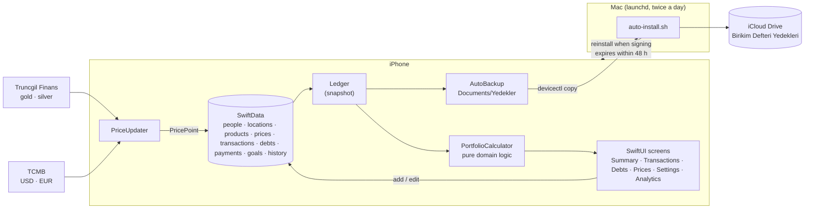

Views read a `Ledger` value, built from SwiftData queries, from the environment. All of the following lives in `PortfolioCalculator`, which knows nothing about SwiftUI:

- average-cost balances, transfers and sale validation
- grouping and missing prices
- the person filter
- value history and realized profit/loss
- monthly flows and the location breakdown
- values in dollars or gold, goal progress and debt payoff estimates

### Project structure

```
BirikimDefteri/
├── App/             App entry, root view, Face ID lock
├── Core/            Pure layer: types, PortfolioCalculator, tr_TR formatting, price parsing
├── Models/          SwiftData models, Ledger, change journal, JSON backup, CSV export, reminders, price updater, auto backup, demo data
├── Views/           Summary, Transactions, Debts, Prices, Settings, Analytics; icons and theme
└── Assets.xcassets  App icon, logo, colors
BirikimDefteriTests/ Swift Testing unit tests
scripts/             install.sh (device install), auto-install.sh (scheduled re-signing and backups), fetch-logos.py (local bank logos), app-icon.swift (app icon)
docs/                README images
```

### Privacy

- Data lives only in the on-device SwiftData store. No accounts, servers, analytics or ads.
- Network requests go only to two public endpoints and carry no personal data: `finans.truncgil.com/today.json` and `www.tcmb.gov.tr/kurlar/today.xml`.
- Automatic backups stay in the app's own container and are copied only by the owner's Mac to the owner's iCloud Drive.
- The app never downloads logos. `fetch-logos.py` runs on the Mac and the logos are bundled at build time.
- The demo data (`DemoData.swift`) and test fixtures in this repository are synthetic.

### Price sources

| Product | Source | Price |
|---|---|---|
| Gram, quarter, half, full, Republic, Reşat, Ata gold coins; 22/18/14 karat | [Truncgil Finans](https://finans.truncgil.com/today.json) | Grand Bazaar bid |
| Gram silver | Truncgil Finans | Bid |
| USD, EUR | [TCMB](https://www.tcmb.gov.tr/kurlar/today.xml) (fallback: Truncgil) | Forex buying rate |

Products are recognized by name (`Core/Quotes.swift`). Fund and lira prices stay manual. The Truncgil response is sometimes truncated, so the app retries and also extracts values from partial responses. Valuing holdings at the bid price is deliberate: it shows what you would actually receive if you sold.

### Getting started

**Requirements:** Xcode 16 or later (built with Xcode 27), an iPhone on iOS 17 or later, and a free Apple account (Personal Team).

1. In Xcode > Settings > Apple Accounts, add your Apple account, then create a certificate with **Manage Certificates… > + > Apple Development**.
2. Connect the iPhone with a cable and tap **Trust This Computer**. Turn on **Settings > Privacy & Security > Developer Mode**.
3. Build and install. The script reads your signing team from the certificate:

   ```bash
   ./scripts/install.sh
   ```

4. On first launch, trust the developer under **Settings > General > VPN & Device Management** on the iPhone.

For your own copy, change `PRODUCT_BUNDLE_IDENTIFIER`. To run from Xcode, pick your team under Signing & Capabilities.

### Free signing lasts 7 days

With a free account, the app's signature expires after 7 days. This installs a launchd job that runs every day at 09:00 and 20:30:

```bash
./scripts/auto-install.sh --enable
```

Each run:
- pulls new backups from the iPhone to iCloud Drive,
- reinstalls the app over Wi-Fi or cable if the signature expires within 48 hours,
- reports the result with a Mac notification.

Each install fetches a fresh 7-day profile and keeps the app's data. The iPhone only needs to be on the same network as the Mac. The log is at `~/Library/Logs/BirikimDefteri/auto-install.log`; remove the job with `--disable`.

### Backup and restore

- **Automatic:** whenever data changes, the app writes a timestamped JSON backup to `Documents/Yedekler` and keeps the last 30. The Mac job copies them to **iCloud Drive > Birikim Defteri Yedekleri** and keeps the last 90.
- **Manual:** Settings > export or restore a backup. Restoring replaces all existing data.
- **Merge without deleting:** drop a backup-format file into the app's Documents folder as `BirikimDefteri-ekle.json`. On next launch the app merges it into the existing data, matching people, locations and products by name and updating records with the same ID:

  ```bash
  xcrun devicectl device copy to --device <UDID> --domain-type appDataContainer \
    --domain-identifier com.kadirtuna.birikimdefteri --source ekle.json --destination Documents/BirikimDefteri-ekle.json
  ```

### Development

```bash
xcodebuild test -project BirikimDefteri.xcodeproj -scheme BirikimDefteri \
  -destination 'platform=iOS Simulator,name=iPhone 14' -parallel-testing-enabled NO
```

Parallel testing is off because it clones the simulator on every run and fills the disk.

To launch with demo data in the Simulator (Debug builds only; replaces existing data and skips the lock):

```bash
xcrun simctl launch booted com.kadirtuna.birikimdefteri -demoData
```

### License

[MIT](LICENSE) © 2026 Kadir Tuna

---

<a id="turkce"></a>

## Türkçe

**Birikim Defteri**, altın, gümüş, döviz, fon ve TL birikimlerini; kimde, nerede ve ne maliyetle durduklarını takip eden kişisel bir iPhone uygulaması. Bütün veriler cihazda kalır: sunucu yok, hesap yok, analitik yok. İnternete yalnızca herkese açık güncel fiyatları almak için çıkılır.

### Öne çıkanlar

- **Net varlık özeti:** varlıklar, borçlar ve kâr/zarar tek kartta; bugünkü değişim ve fiyatların son güncellenme saatiyle. Aşağı çekince fiyatlar yenilenir. Kişi filtresi (Herkes / tek kişi) ve ürüne, türe, kişiye ya da yere göre halka grafik; dilime dokununca tutarı ve payı görünür. 7 gün içindeki ödemeler Özet'te listelenir, Borçlar sekmesinde rozet çıkar.
- **Ortalama maliyet yöntemi:** bakiyeler hiçbir yerde saklanmaz; her zaman işlemlerden hesaplanır (kişi × ürün × yer). Satış, ortalama maliyetten düşer. Eldekinden fazla satış ve sonraki bir satışı karşılıksız bırakan düzenleme ya da silme engellenir.
- **Analiz:**
  - değer ve maliyet geçmişi; grafiğe dokunup herhangi bir günü görebilirsiniz
  - aynı geçmiş TL, dolar ya da gram altın cinsinden; enflasyonun ötesindeki gerçek büyümeyi görmek için
  - türlerin zaman içindeki payı
  - aylık alım ve satım
  - alış maliyetine göre ürün getirisi, ürünün piyasa fiyatındaki değişimden ayrı olarak
  - gerçekleşen kâr/zarar
  - borç/varlık oranı ve aylık taksit gibi temel göstergeler
  - paylaşılabilir, tek sayfalık aylık PDF rapor
- **Varlıklarım nerede?:** banka, aracı kurum ve fiziki yer başına içerik, toplam ve pay.
- **Aktarım:** varlığı bir yerden ötekine (ör. kasadan banka hesabına) sahte alım-satım yapmadan taşıma; maliyet de birlikte taşınır.
- **Hedefler:** net varlık ya da ürün miktarı hedefi (ör. 100 gr altın); ilerleme ve son 3 aydaki hıza göre tahmini tarih.
- **Güncel fiyatlar:** altın çeşitleri, bilezik ve gümüş için Kapalıçarşı alış fiyatı, dolar ve euro için TCMB kuru; her birinde 30 günlük mini grafik ve değişim rozeti. Fiyatlar her zaman elle de girilebilir.
- **Borçlar:** kredi, kredi kartı ve diğer; kuruma göre gruplama, türe göre ara toplamlar, aylık taksit toplamı. Her borcun ödeme geçmişi, ödenen kısmı gösteren halkası ve tahmini bitiş tarihi tutulur; kart son ödeme ve taksit günleri yerel bildirimle hatırlatılır.
- **Hızlı kayıt:** tutarlar yazılırken binlik ayraçla gösterilir (1.234,50), yeni kayıtta son kişi ve yer hazır gelir, bir kayıt kaydırarak ya da uzun basma menüsünden (Düzenle, Tekrarla, Aktar, Sil) bugünün tarihiyle tekrarlanır. Kayıtlarda arama var; ay başlıklarında o ayın toplam alım ve satımı yazar.
- **Hiçbir şey kaybolmaz:** işlem, aktarım, borç ve ödemelerdeki her değişiklik kaydedilir ve geri alınabilir. Silmeler (hedef, kişi, yer ve fiyat geçmişiyle ürünler dahil) ve yedekten geri yüklemeler Silinenler'de hep kalır, istendiğinde geri getirilir; geri yükleme de geri alınabilir.
- **Siri ve Kısayollar:** "Birikim Defteri ile alım ekle" ile uygulamayı açmadan alım ya da satım eklenir; son kişi ve yer, güncel fiyat kullanılır. Kısayollar uygulamasında ve Eylem düğmesinde de çalışır.
- **Güvenlik:** zorunlu Face ID kilidi, cihaz şifresi yedekli. Uygulama değiştiricide içerik gizlenir; göz düğmesiyle yanınızda biri varken bütün tutarlar gizlenir.
- **Yedek ve dışa aktarma:** JSON dışa ve içe aktarma. Otomatik yedekler kullanıcının Mac'i tarafından iCloud Drive'a çekilir. İşlemler, varlıklar ve borçlar Excel'de doğrudan açılan CSV olarak dışa aktarılır.
- **Banka logoları:** Türkiye'deki 54 banka ve aracı kurum, saklama yeri ve borç adlarından tanınıp logosuyla gösterilir. Logolar tescilli marka olduğu için bu depoda yer almaz; `scripts/fetch-logos.py` onları kendi derlemeniz için kurumun sitesinden, sitede yalnızca küçük bir favicon varsa resmi App Store uygulamasından indirir. Logo yoksa kurum, marka renginde baş harf rozetiyle görünür.
- **Kullanım kılavuzu:** Ayarlar > Kullanım kılavuzu; her özelliğin ne işe yaradığı, nerede olduğu ve nasıl kullanıldığı, aramalı.
- **Yerel his:** açık ve koyu mod, koyu ve renklendirilmiş uygulama simgesi, Dynamic Type, dokunsal geri bildirim; çizilmiş ürün simgeleri (külçe, sikke, bilezik, döviz rozetleri).

### Teknoloji

| Katman | Kullanılan |
|---|---|
| Arayüz | SwiftUI (TabView, NavigationStack, List/Form), Dynamic Type, açık/koyu mod |
| Veri | SwiftData. Para ve miktarlar kayıpsız kalsın diye `Decimal`, metin olarak saklanır |
| Grafikler | Swift Charts: `SectorMark`, `AreaMark`, `LineMark`, `BarMark`, `RuleMark`, `chartXSelection` |
| Hesaplama | Saf Swift `PortfolioCalculator`; SwiftUI'dan bağımsız, birim testli |
| Güvenlik | LocalAuthentication (`deviceOwnerAuthentication`) |
| Sistem | UserNotifications (yerel hatırlatmalar), App Intents (Siri, Kısayollar), `ImageRenderer` → PDF, `fileExporter` (CSV/JSON) |
| Ağ | `URLSession`; yalnızca herkese açık fiyat kaynakları |
| Test | Swift Testing: 52 test, 18 grup |
| Araçlar | Elle yazılmış Xcode projesi (dosya sistemiyle eşitlenen gruplar), `xcodebuild`, `devicectl`, launchd |
| Bağımlılık | Yok. Üçüncü taraf paket kullanılmıyor. |

### Mimari

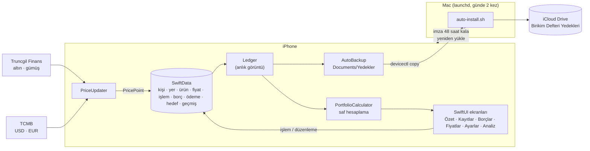

Görünümler, SwiftData sorgularından kurulan `Ledger` değerini ortamdan (environment) okur. Aşağıdakilerin hepsi SwiftUI'ı hiç bilmeyen `PortfolioCalculator` içindedir:

- ortalama maliyetli bakiyeler, aktarımlar ve satış doğrulama
- gruplama ve eksik fiyat
- kişi filtresi
- değer geçmişi ve gerçekleşen kâr/zarar
- aylık akış ve yer dökümü
- dolar ya da altın cinsinden değer, hedef ilerlemesi ve borç bitiş tahmini

### Proje yapısı

```
BirikimDefteri/
├── App/             Uygulama girişi, kök görünüm, Face ID kilidi
├── Core/            Saf katman: tipler, PortfolioCalculator, biçimlendirme (tr_TR), fiyat ayrıştırma
├── Models/          SwiftData modelleri, Ledger, değişiklik günlüğü, yedek (JSON), CSV dışa aktarma, hatırlatmalar, fiyat güncelleyici, otomatik yedek, örnek veri
├── Views/           Özet, Kayıtlar, Borçlar, Fiyatlar, Ayarlar, Analiz; simgeler ve tema
└── Assets.xcassets  Uygulama simgesi, logo, renkler
BirikimDefteriTests/ Swift Testing birim testleri
scripts/             install.sh (cihaza yükleme), auto-install.sh (zamanlanmış yenileme ve yedek), fetch-logos.py (yerel banka logoları), app-icon.swift (uygulama simgesi)
docs/                README görselleri
```

### Gizlilik

- Veriler yalnızca cihazdaki SwiftData deposunda durur. Hesap, sunucu, analitik ya da reklam yok.
- İnternete giden istekler yalnızca şu iki adrese gider ve kişisel veri içermez: `finans.truncgil.com/today.json`, `www.tcmb.gov.tr/kurlar/today.xml`.
- Otomatik yedekler uygulamanın kendi klasöründe tutulur ve yalnızca kullanıcının kendi Mac'i tarafından kendi iCloud Drive'ına kopyalanır.
- Uygulama logo indirmez. `fetch-logos.py` Mac'te çalışır, logolar derleme sırasında uygulamaya eklenir.
- Depodaki örnek veriler (`DemoData.swift`) ve test verileri uydurmadır.

### Fiyat kaynakları

| Ürün | Kaynak | Fiyat |
|---|---|---|
| Gram, çeyrek, yarım, tam, Cumhuriyet, Reşat, Ata altın; 22/18/14 ayar | [Truncgil Finans](https://finans.truncgil.com/today.json) | Kapalıçarşı alış |
| Gram gümüş | Truncgil Finans | Alış |
| Dolar, euro | [TCMB](https://www.tcmb.gov.tr/kurlar/today.xml) (yedek: Truncgil) | Döviz alış |

Ürünler adlarından tanınır (`Core/Quotes.swift`). Fonların ve TL'nin fiyatı elle kalır. Truncgil yanıtı zaman zaman yarıda kesildiği için birkaç kez denenir; kesik yanıttaki değerler de ayıklanır. Değerlemede alış fiyatının kullanılması bilinçli bir tercih: satsanız elinize geçecek tutarı gösterir.

### Kurulum

**Gereksinimler:** Xcode 16 veya üzeri (Xcode 27 ile geliştirildi), iOS 17 veya üzeri bir iPhone, ücretsiz bir Apple hesabı (Personal Team).

1. Xcode > Settings > Apple Accounts'tan Apple hesabınızı ekleyin, ardından **Manage Certificates… > + > Apple Development** ile sertifika oluşturun.
2. iPhone'u kabloyla bağlayıp **Bu Bilgisayara Güven** deyin. **Ayarlar > Gizlilik ve Güvenlik > Geliştirici Modu**'nu açın.
3. Derleyip yükleyin. Betik, imza takımını sertifikanızdan kendisi okur:

   ```bash
   ./scripts/install.sh
   ```

4. İlk açılışta iPhone'da **Ayarlar > Genel > VPN ve Aygıt Yönetimi**'nden geliştiriciye **Güven** deyin.

Kendi kopyanız için `PRODUCT_BUNDLE_IDENTIFIER` değerini değiştirin. Xcode'dan çalıştıracaksanız Signing & Capabilities'te takımınızı seçin.

### Ücretsiz imzanın 7 günlük süresi

Ücretsiz hesapla imza 7 gün geçerli. Aşağıdaki komut, her gün 09:00 ve 20:30'da çalışan bir launchd görevi kurar:

```bash
./scripts/auto-install.sh --enable
```

Görev her çalıştığında:
- iPhone'daki yeni yedekleri iCloud Drive'a çeker,
- imzanın bitmesine 48 saatten az kaldıysa uygulamayı kablosuz ya da kabloyla yeniden yükler,
- sonucu Mac bildirimiyle haber verir.

Yükleme her seferinde yeni bir 7 günlük profil alır; veriler silinmez. Telefonun Mac ile aynı ağda olması yeterli. Kayıt `~/Library/Logs/BirikimDefteri/auto-install.log` dosyasında; kaldırmak için `--disable`.

### Yedekleme ve geri yükleme

- **Otomatik:** Uygulama, veriler değiştikçe `Documents/Yedekler` klasörüne tarihli bir JSON yazar ve son 30'unu tutar. Mac'teki görev bunları **iCloud Drive > Birikim Defteri Yedekleri** klasörüne çeker ve son 90'ını tutar.
- **Elle:** Ayarlar > Yedeği dışa aktar / Yedekten geri yükle. Geri yükleme mevcut verinin yerine geçer.
- **Silmeden ekleme:** Yedek biçimindeki bir dosya uygulamanın Documents klasörüne `BirikimDefteri-ekle.json` adıyla bırakılırsa, uygulama açılışta onu mevcut verilere ekler. Kişi, yer ve ürünleri adla eşleştirir; aynı kimlikli kayıtları günceller:

  ```bash
  xcrun devicectl device copy to --device <UDID> --domain-type appDataContainer \
    --domain-identifier com.kadirtuna.birikimdefteri --source ekle.json --destination Documents/BirikimDefteri-ekle.json
  ```

### Geliştirme

```bash
xcodebuild test -project BirikimDefteri.xcodeproj -scheme BirikimDefteri \
  -destination 'platform=iOS Simulator,name=iPhone 14' -parallel-testing-enabled NO
```

Paralel test, her çalıştırmada simülatörün bir kopyasını oluşturup diski doldurduğu için kapalı.

Örnek veriyle simülatörde açmak için (yalnızca Debug derleme; mevcut veriyi siler, kilidi atlar):

```bash
xcrun simctl launch booted com.kadirtuna.birikimdefteri -demoData
```

### Lisans

[MIT](LICENSE) © 2026 Kadir Tuna
